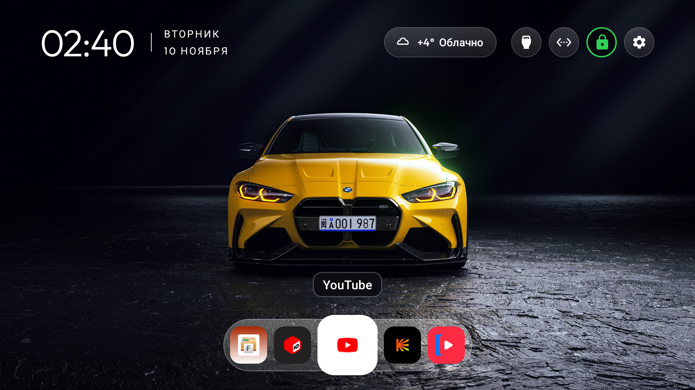
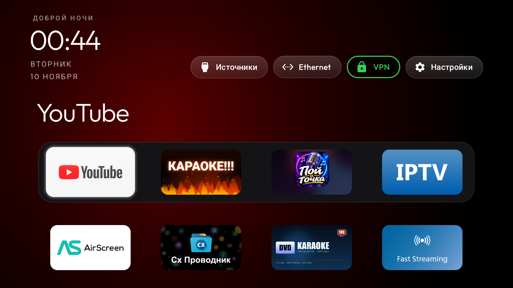
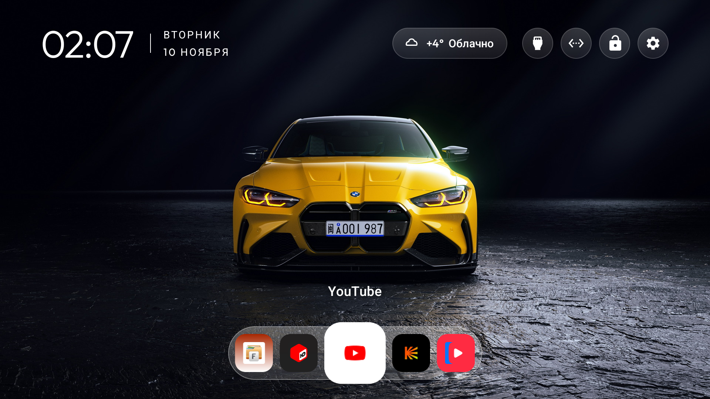

<div align="center">

# TV Cinema Launcher

**An Android TV home screen: an endless app carousel, frosted dock, clock, weather and a VPN button — as in the reference video.**

[](LICENSE)
[](https://github.com/mosloboev444-hue/tv-cinema-launcher/releases/latest)
[](https://developer.android.com/tv)
[](#)

</div>



A fork of the [CleanYourTV](https://github.com/Gathin23/cleanyourtv) 3.4 launcher with two home screens and
a switch between them right on the TV:

- **“Cinema”** — the reference look: clock and date in the corner, a weather chip, round header buttons
  (Inputs, Wi-Fi, VPN, Settings), a frosted dock of app icons over a photo wallpaper and an **endless
  carousel of every installed app**; the focused app is enlarged with a white ring and its name above.
- **“Classic”** — the previous CleanYourTV 3.2 home screen, pixel-identical: greeting, dock cards, app rows.

Built for a Philips 50PUS8057/60 (Android TV 14) and tested on it. Works on Android TV 8.0+.

## Features

| | |
|---|---|
| **Two screens** | “Cinema” and “Classic”, switched with the remote: hold OK on Settings → “Screen: …” |
| **Endless carousel** | all installed apps in a ring, 7 tiles on screen, the last one eases into the first |
| **Weather** | glass chip in the header: icon, temperature, short description; city by public IP, 30-minute cache |
| **VPN button** | round button in the header: green = VPN on, red = off; opens the configured VPN app |
| **App name badge** | two neutral styles above the focused tile: “Glass” (dark glass chip) and “Text only” |
| **Sounds** | soft carousel tick on focus change and a deeper confirm thud on OK; synthesised in code |
| **Smoothness** | layout-free carousel: 5.46 % janky frames, 11 ms median, 28 ms p90, 0 missed vsync |
| **Wallpaper** | sharp 4K photo wallpaper included; your own can be pushed over ADB |
| **No ads, no accounts** | only one weather request pair per 30 minutes, no telemetry |

## Screenshots

| | |
|---|---|
|  |  |
| **Cinema** — weather, glass chip, dock | **Classic** — the original 3.2 look |
|  |  |
| **“Glass” badge** (default) | **“Text only” badge** |

More: [weather/focus](screenshots/home-cinema-weather-focus.png),
[carousel frames](screenshots/carousel-animation-frames.jpg), [RuTube](screenshots/home-cinema-rutube.png),
[torrents](screenshots/home-cinema-torrserve.png), [IPTVPORTAL](screenshots/home-cinema-iptvportal.png),
[karaoke](screenshots/home-cinema-karaoke.png), [YouTube](screenshots/home-cinema-youtube.png).

## Install

Download the APK from [Releases](https://github.com/mosloboev444-hue/tv-cinema-launcher/releases/latest)
(`CleanYourTV-TwoScreens-3.4.apk`, 588 KB, versionCode 13 / 3.4) and install it:

```bash
adb connect 192.168.0.39:5555
adb install -r CleanYourTV-TwoScreens-3.4.apk
```

It is signed with the same debug key as previous CleanYourTV 3.2/3.4 builds, so it installs as an update:
the Home role and app data are kept. Android TV 8.0+ (minSdk 26, targetSdk 34).

## Switching screens

1. Press and **hold OK** on the **Settings** button (gear in the header).
2. Choose **“Screen: Cinema”** or **“Screen: Classic”** and press OK — the screen changes immediately.
   On the Cinema screen the row above it switches the name badge style.
3. The choice is remembered across reboots.

## Weather and privacy

The launcher gained the **INTERNET** permission for the weather chip only: the city comes from the public
IP (`ipwho.is`), the reading from `wttr.in` (fallback `api.met.no`), cached in SharedPreferences for
30 minutes. No other network access, no telemetry, no background services.

## Build

Requires JDK 17+ and Android SDK 34:

```bash
cd launcher
echo "sdk.dir=/path/to/Android/Sdk" > local.properties
./gradlew assembleRelease
# APK: launcher/app/build/outputs/apk/release/app-release.apk
```

The build is signed with the debug key from `~/.android/debug.keystore`, so it updates over earlier builds.
The patches in `build/` reproduce the feature on a clean upstream 3.4 (`karaoke-3.4.patch`,
`launcher-two-screens.patch`).

## Rollback

- Back to the classic look: hold OK on Settings → “Screen: Classic”.
- Back to a clean CleanYourTV 3.2 without the new screens: `adb install -r -d CleanYourTV-Karaoke-3.2.apk`
  from the [previous project](https://github.com/mosloboev444-hue/android-tv-youtube-vpn-karaoke).

## License and credits

- **MIT** — see [LICENSE](LICENSE).
- Based on [CleanYourTV](https://github.com/Gathin23/cleanyourtv) © 2026 Gathin, MIT. Thanks to the author.
- The fire “KARAOKE!!!” tile and the VPN gate come from
  [android-tv-youtube-vpn-karaoke](https://github.com/mosloboev444-hue/android-tv-youtube-vpn-karaoke).
- Wallpapers: [Wallhaven](https://wallhaven.cc/w/d6yz6j) (BMW M4), rights belong to their owners, used as
  personal wallpapers.

## Related projects

- [SlimHome](https://github.com/mosloboev444-hue/slimhome) — Android TV launcher: grid, weather, glass UI.
- [SlimTube](https://github.com/mosloboev444-hue/slimtube), [SlimIPTV](https://github.com/mosloboev444-hue/slimiptv),
  [SlimVPN](https://github.com/mosloboev444-hue/slimvpn), [SlimTV Suite](https://github.com/mosloboev444-hue/slimtv-suite).

---

Made for personal use and shared in case it helps someone. Issues and PRs welcome.
