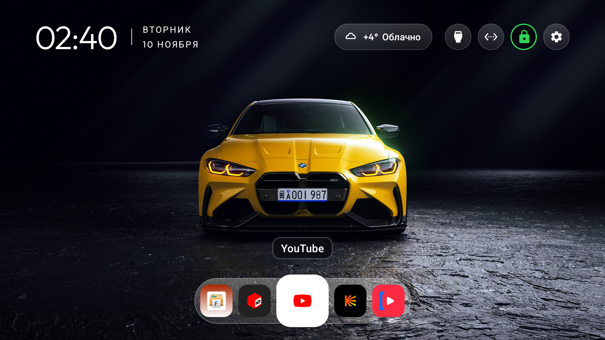
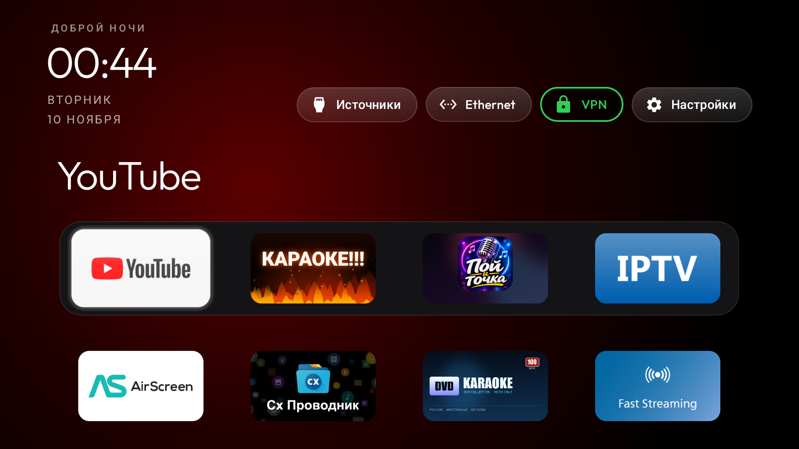
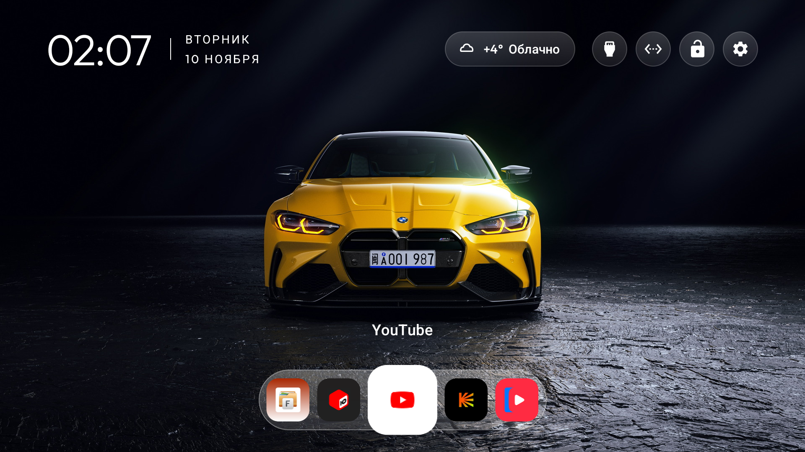
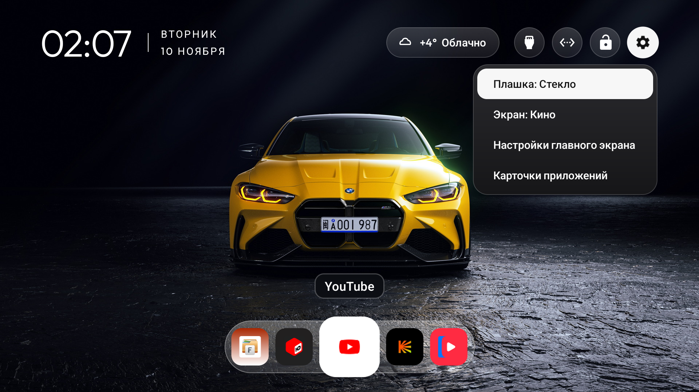
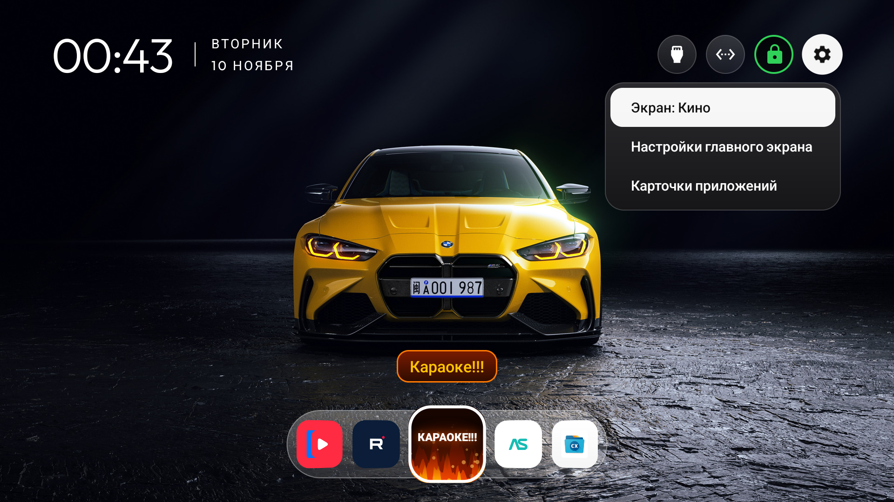
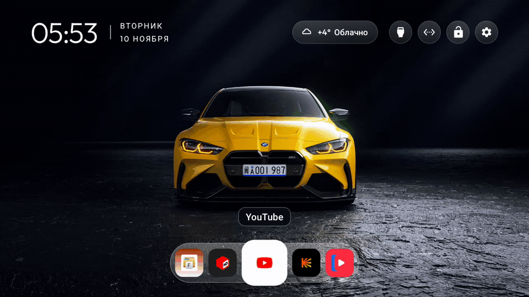
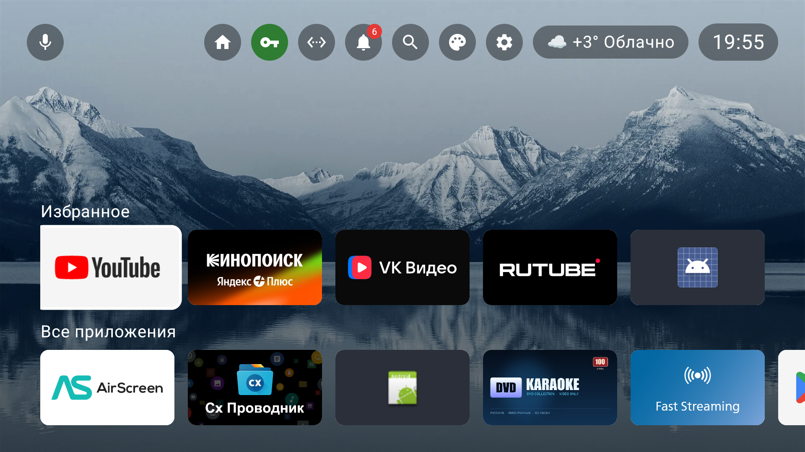
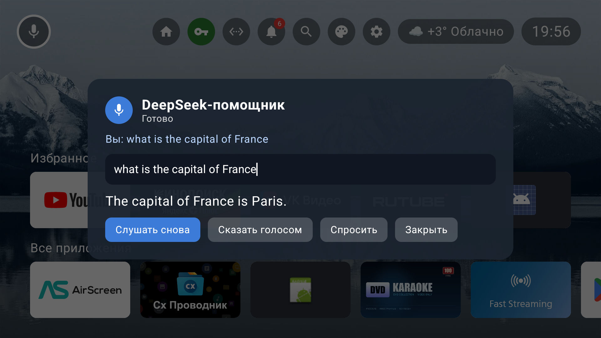

<div align="center">

# TV Cinema Launcher

**Три домашних экрана для Android TV: карусель как в видео, классический экран и универсальный с DeepSeek-помощником.**

[](LICENSE)
[](https://mosloboev444-hue.github.io/tv-cinema-launcher/)
[](https://github.com/mosloboev444-hue/tv-cinema-launcher/releases/latest)
[](https://developer.android.com/tv)
[](https://platform.deepseek.com/)
[](#)

</div>

**Сайт проекта:** <https://mosloboev444-hue.github.io/tv-cinema-launcher/>
([English](https://mosloboev444-hue.github.io/tv-cinema-launcher/en/)) ·
**Скачать APK:** [релизы](https://github.com/mosloboev444-hue/tv-cinema-launcher/releases/latest)



Форк лаунчера [CleanYourTV](https://github.com/Gathin23/cleanyourtv) 3.4 с **тремя домашними экранами** и
переключением между ними прямо на телевизоре:

- **«Кино»** — минималистичный экран из видео: часы и дата в углу, погода в стеклянной плашке, круглые
  кнопки (Источники, Wi-Fi, VPN, Настройки), морозный док с иконками на фоне фотообоев и **бесконечная
  карусель всех приложений по кругу**; выбранное приложение увеличено, с белым кольцом и названием над ним.
- **«Классика»** — прежний домашний экран CleanYourTV 3.2, пиксель в пиксель: приветствие, док-карточки,
  строки приложений.
- **«Универсальный»** — экран в духе Google TV: фотообои (горы и озеро), минималистичный верхний бар,
  «Избранное» и «Все приложения», кнопка VPN. Вместо Google-ассистента — **DeepSeek**: голосовой помощник,
  который открывает приложения, переключает экраны, показывает погоду, меняет громкость и отвечает на вопросы.

Сделано для Philips 50PUS8057/60 (Android TV 14) и проверено на нём же. Подходит для любого Android TV
8.0+.

## Что умеет

| | |
|---|---|
| **Три экрана** | «Кино», «Классика» и «Универсальный»; переключение с пульта: удерживать ОК на «Настройки» → «Экран: …» (и кнопка-домик в баре универсального экрана) |
| **DeepSeek-помощник** | микрофон в универсальном экране: распознавание речи, ответы DeepSeek, озвучка TTS; локальные команды работают без сети |
| **Карусель по кругу** | все установленные приложения в кольце, 7 плиток на экране, конец списка плавно переходит в начало |
| **Погода** | стеклянная плашка в шапке: иконка, температура, короткое описание; город по публичному IP, кэш на 30 минут |
| **Кнопка VPN** | «Кино»/«Классика»: круглая кнопка, зелёная — VPN включён, красная — выключен, открывает настроенное приложение. «Универсальный»: нейтральная капсула с названием выбранного VPN, поднимает встроенный AmneziaWG |
| **Название приложения** | два нейтральных стиля над выбранной плиткой: «Стекло» (тёмная стеклянная плашка) и «Без фона» (только текст) |
| **Звуки** | мягкий «тик» при перелистывании карусели и глубокий «тук» подтверждения; синтезируются кодом, без файлов |
| **Плавность** | карусель без пересчёта разметки: 5.46 % «дёрганых» кадров, медиана 11 мс, p90 28 мс, пропущенных vsync 0 |
| **Универсальность** | Android TV 8.0+, приставки без пометки Leanback, масштаб под HD/FHD/4K, пульт и мышь |
| **Свой VPN** | кнопка VPN на универсальном экране поднимает собственный туннель AmneziaWG (WARP) прямо в лаунчере; повторное нажатие выключает |
| **Обои** | фотообои с идеальной резкостью (4K-исходник); можно поставить свои |
| **Без рекламы и аккаунтов** | только погода раз в 30 минут (одна пара запросов), без телеметрии |

## Скриншоты

| | |
|---|---|
|  |  |
| **Экран «Кино»** — погода, стеклянная плашка, док | **Экран «Классика»** — прежний вид 3.2 |
|  |  |
| **Плашка «Стекло»** (по умолчанию) | **Плашка «Без фона»** |
|  |  |
| **Выбор плашки** в меню | **Переключение экранов** там же |

**Карусель в движении (GIF, записано на ТВ):**



|  |  |
| **«Универсальный»** — фотообои, «Избранное» и «Все приложения» | **DeepSeek-помощник** — ответ на вопрос |

Ещё: [погода и фокус в шапке](screenshots/home-cinema-weather-focus.png),
[кадры карусели](screenshots/carousel-animation-frames.jpg),
[RuTube](screenshots/home-cinema-rutube.png), [торренты](screenshots/home-cinema-torrserve.png),
[IPTVPORTAL](screenshots/home-cinema-iptvportal.png), [Караоке](screenshots/home-cinema-karaoke.png),
[YouTube](screenshots/home-cinema-youtube.png).

## Установка

**Скачать:** [APK из Releases](https://github.com/mosloboev444-hue/tv-cinema-launcher/releases/latest) —
`CleanYourTV-ThreeScreens-4.1.7.apk` (7.1 МБ, versionCode 26 / 4.1.7).

Поставить по ADB на телевизор:

```bash
adb connect 192.168.0.39:5555        # порт ADB на вашем ТВ
adb install -r CleanYourTV-ThreeScreens-4.1.7.apk
```

Или скопировать APK на флешку и установить любым файловым менеджером (например, X-plore).

- APK подписан тем же debug-ключом, что прежние сборки CleanYourTV 3.2/3.4, поэтому ставится
  **обновлением поверх**: роль «Домой», настройки и данные сохраняются.
- Нужен Android TV 8.0+ (minSdk 26, targetSdk 34).
- После установки выберите приложение как «Домой», если система спросит.

## Переключение экранов

1. Нажмите и **удерживайте ОК** на кнопке **«Настройки»** (шестерёнка в шапке).
2. В меню найдите строку **«Экран: Кино»** или **«Экран: Классика»** и нажмите ОК — экран сменится сразу.
   На экране «Кино» над ней есть строка **«Плашка: …»** — стиль названия приложения.
3. Выбор запоминается и переживает перезагрузку ТВ.

## Что на экране «Кино»

- **Часы и дата** в левом верхнем углу, дата в две строки (`ВТОРНИК / 10 НОЯБРЯ`).
- **Погода** — стеклянная плашка в шапке: тонкая иконка, температура, короткое описание («+4° Облачно»).
- **Круглые кнопки**: Источники, Wi-Fi/Ethernet, VPN, Настройки. Иконки без подписей, как в видео.
- **Док** — морозная стеклянная полоса с иконками приложений: YouTube, Кинопоиск, VK Видео, RuTube,
  VPN Gate. Нажмите вверх/вниз — фокус уходит в шапку и возвращается.
- **Карусель** — все приложения по кругу: выбранная плитка увеличивается (×1.62), получает белое кольцо,
  над ней появляется название; соседние плитки подсказывают, что список бесконечный.
- **Ничего лишнего** внизу: только док и карусель, как в референсе.

## Название приложения (плашка)

Два варианта, переключение там же в меню («Плашка: …»), выбор запоминается:

- **«Стекло»** (по умолчанию) — тёмная почти непрозрачная стеклянная плашка, тонкая светлая окантовка,
  белый текст. Ближе всего к видео.
- **«Без фона»** — только название белым с мягкой тенью, ничего не перекрывает обои.

## Третий экран «Универсальный»

Экран в духе Google TV, сделан на Jetpack Compose и работает на любом Android TV 8.0+ и приставке:

- **Фотообои** — горы и озеро (по умолчанию; в настройках можно выбрать закат, ночь или автосмену каждые 10 минут).
- **Верхний бар** — микрофон (DeepSeek-помощник), кнопка «Домашний экран», VPN (нейтральная капсула
  с названием выбранного VPN), сеть,
  уведомления со счётчиком, поиск, палитра (настройки лаунчера), настройки TV, погода и часы.
- **«Избранное» и «Все приложения»** — два ряда карточек с баннерами; OK открывает, долгое OK — меню
  приложения (в избранное, порядок, сведения).
- **Настройки лаунчера** (палитра): обои, тема звуков, громкость, заставка с часами, ключ DeepSeek.
- Масштаб интерфейса рассчитан на 960 dp и подстраивается под HD, Full HD и 4K; пульт, мышь и тачпад.

## DeepSeek-помощник

Микрофон в верхнем баре открывает помощника. Голос распознаётся на телевизоре, ответ показывает и
**озвучивает TTS**. Команды лаунчера выполняются локально и мгновенно, без сети:

- «Открой YouTube», «запусти Кинопоиск» — запуск приложений;
- «Включи / выключи VPN» — VPN-приложение или системные настройки VPN;
- «Погода» — текущая погода в шапке; «громче / тише / выключи звук»; «который час»;
- «Кино», «классика» — переключение домашнего экрана.

Всё остальное уходит в **DeepSeek** (`deepseek-chat`) и озвучивается. Без ключа помощник подскажет, где
его взять; без микрофона можно задать вопрос текстом с пульта.

### Ключ DeepSeek

Ключ хранится **только на телевизоре** и никогда не попадает в APK или репозиторий. Два способа:

1. На ТВ: палитра → **«DeepSeek: ключ»** → вставить ключ с [platform.deepseek.com](https://platform.deepseek.com/)
   (кнопка ОК сохраняет).
2. По ADB — файлом (удобно для длинного ключа):

```bash
echo -n "sk-..." > deepseek_key.txt
adb push deepseek_key.txt /sdcard/Android/data/com.gathin.tvhome/files/deepseek_key.txt
adb shell am force-stop com.gathin.tvhome && adb shell input keyevent KEYCODE_HOME
```

Разрешение на микрофон выдаётся при первом запуске помощника (или `adb shell pm grant
com.gathin.tvhome android.permission.RECORD_AUDIO`).

## Свой VPN (AmneziaWG)

Кнопка VPN на универсальном экране больше не открывает чужое приложение — она **поднимает собственный
туннель внутри лаунчера**. Движок — AmneziaWG (WireGuard с обфускацией против DPI), тот же, что в
проекте [SlimVPN](https://github.com/mosloboev444-hue/slimvpn).

- **Одно нажатие** — включить; ещё одно — выключить. Пока туннель поднят, к названию на кнопке
  добавляется «· вкл».
**На кнопке видно, какой VPN выбран**: нейтральная капсула с иконкой ключа и названием («Мой VPN»
или приложение) внутри; когда туннель поднят, к названию добавляется «· вкл».

**Как работает кнопка.** Она включает то, что выбрано в строке «Источник VPN»:
«Мой VPN (AmneziaWG)» — поднимает встроенный туннель; любое другое приложение — открывает его.
При переключении на приложение встроенный туннель выключается, чтобы VPN не было два сразу.

- **Долгое ОК** — меню «Мой VPN»: профили `.conf`, выбор активного, «Обновить профили»,
  «Другие VPN-приложения» и системные настройки.
- Работает в том числе в сетях, где обычный WireGuard режется DPI (эти WARP-конфиги для того и сделаны).

**Где профили.** Файлы `*.conf` в формате AmneziaWG/WARP лежат только на телевизоре, в папке приложения:

```bash
adb push STR.WARP59009.conf /sdcard/Android/data/com.gathin.tvhome/files/vpn/
# затем: долгое ОК на VPN → «Обновить профили»
```

В APK и в репозитории профилей нет — ключи в них личные, поэтому в поставку они не попадают.
Движок собран под `armeabi-v7a` (как у этого Philips); на 64-битном телевизоре кнопка честно сообщит,
что движок недоступен, и предложит внешнее VPN-приложение.

## Погода

- Город определяется по публичному IP (`ipwho.is`), погода — `wttr.in` (короткие русские описания),
  резервный источник — `api.met.no`. Без API-ключей.
- **Кэш 30 минут**: при возврате на Home значение показывается сразу, обновление — только если данные
  старше получаса и только пока Home на экране. Фонового сервиса нет.
- Без сети или при ошибке остаётся последнее значение; плашка не гаснет и ничего не подвешивает.
- В лаунчер добавлено разрешение **INTERNET** — только для этого запроса. Других обращений в сеть нет:
  ни телеметрии, ни аналитики, ни фоновых задач.

## Плавность и отзывчивость

Карусель переписана так, чтобы не пересчитывать разметку на каждом кадре: плитки раскладываются один раз,
дальше двигаются и масштабируются трансформациями; арт (цвет плиток) готовится в фоне.

| Метрика | Было (обычная сетка) | Стало (карусель) |
|---|---|---|
| «Дёрганые» кадры | 36.5 % | **5.46 %** |
| Медиана кадра | 22 мс | **11 мс** |
| 90-й перцентиль | 46 мс | **28 мс** |
| Пропущенные vsync | 2 | **0** |

Звуки: «тик» при перелистывании (мягкий, ~1180 Гц) и «тук» подтверждения (глубокий, 210→108 Гц) —
синтезируются в WAV при первом запуске и играются через `SoundPool`.

## Обои

В репозитории: `wallpapers/` — жёлтый BMW M4 (G82) в тёмной студии, 1920×1080 и 4K-версия
(источник: [Wallhaven d6yz6j](https://wallhaven.cc/w/d6yz6j), бесплатно для личного использования).
Старая реконструкция обоев из видео — `wallpaper-bmw-m5-cs-1920x1080.jpg`.

Поставить свои обои на ТВ:

```bash
adb push мои-обои.jpg /data/local/tmp/w.jpg
adb shell "content write --uri content://com.gathin.tvhome.theme/wallpaper.jpg < /data/local/tmp/w.jpg"
adb shell am force-stop com.gathin.tvhome && adb shell input keyevent KEYCODE_HOME
```

## Проверка на сбои

Прогон на самом телевизоре: холодный/тёплый старт, 40+ быстрых переключений карусели подряд, запуск
приложений и возврат, долгое ОК (карточка приложения), смена экранов ×6, сценарии «Классики», принудительно
мало памяти (`RUNNING_LOW`/`RUNNING_CRITICAL`). Крашей и ANR нет; предупреждений layout в логе нет.
По итогам проверки исправлены: двойной layout-проход на старте, пункт «Плашка» на «Классике» и лишняя
работа при подготовке арта. Подробности — в [README](README.md#проверка-на-сбои).

## Структура репозитория

```
apk/            CleanYourTV-ThreeScreens-4.1.7.apk  — готовая сборка
launcher/       исходники (Java + Kotlin/Compose + движок AmneziaWG и libwg-go.so)
screenshots/    скриншоты с телевизора
wallpapers/     обои (1080p и 4K)
patch/          патч караоке-плитки (остальная функциональность — в launcher/)
build/          скрипты сборки, с которыми делалась сборка
reference/      референс и спецификация экрана из видео
```

## Сборка из исходников

Нужны JDK 17+ и Android SDK 34 (Kotlin и Compose подтянутся из Maven). Собрать из `launcher/`:

```bash
cd launcher
echo "sdk.dir=/путь/к/Android/Sdk" > local.properties
./gradlew assembleRelease
# APK: launcher/app/build/outputs/apk/release/app-release.apk (~7.1 МБ)
```

Сборка подписывается debug-ключом из `~/.android/debug.keystore` (как в upstream CleanYourTV), поэтому
APK ставится обновлением поверх прежних сборок. Вся функциональность уже в `launcher/` (Java-экраны + Kotlin/Compose); отдельный патч нужен только
для караоке-плитки — `build/karaoke-3.4.patch`.

## Откат

- На экран «Классика» — удерживать ОК на «Настройки» → «Экран: Классика» (ничего переустанавливать не нужно).
- С «Универсального» — кнопка-домик в верхнем баре → «Кино» или «Классика».
- На сборку CleanYourTV 3.2 без новых экранов: `adb install -r -d CleanYourTV-Karaoke-3.2.apk`
  (из [старого проекта](https://github.com/mosloboev444-hue/android-tv-youtube-vpn-karaoke)).

## Лицензия и благодарности

- Проект распространяется по лицензии **MIT** — см. [LICENSE](LICENSE).
- Основа: [CleanYourTV](https://github.com/Gathin23/cleanyourtv) © 2026 Gathin, MIT. Огромное спасибо
  автору за лаунчер, на котором это сделано.
- Плитка «КАРАОКЕ!!!» с огнём и VPN-гейт — из проекта
  [android-tv-youtube-vpn-karaoke](https://github.com/mosloboev444-hue/android-tv-youtube-vpn-karaoke).
- Обои: [Wallhaven](https://wallhaven.cc/w/d6yz6j) (BMW M4) и горное озеро (обои универсального экрана),
  права принадлежат правообладателям, используются как личные обои.
- Голосовой помощник работает через [DeepSeek API](https://platform.deepseek.com/); идея выросла из проекта
  [deepseek-alisa](https://github.com/mosloboev444-hue/deepseek-alisa).
- Универсальный экран — Jetpack Compose for TV (androidx.tv).
- Свой VPN — движок [AmneziaWG](https://github.com/amnezia-vpn/amneziawg-android) (Apache-2.0),
  Android-обвязка из [SlimVPN](https://github.com/mosloboev444-hue/slimvpn); лицензия в
  [LICENSE-AMNEZIAWG.txt](LICENSE-AMNEZIAWG.txt).
- Референс: видео с домашним экраном BMW M5 G90 (в репозитории только спецификация и кадры-макеты,
  самого видео нет).

## Другие проекты

- [SlimHome](https://github.com/mosloboev444-hue/slimhome) — лаунчер для Android TV: сетка, погода, стекло.
- [SlimTube](https://github.com/mosloboev444-hue/slimtube), [SlimIPTV](https://github.com/mosloboev444-hue/slimiptv),
  [SlimVPN](https://github.com/mosloboev444-hue/slimvpn), [SlimTV Suite](https://github.com/mosloboev444-hue/slimtv-suite).
- [Android TV YouTube VPN + Karaoke](https://github.com/mosloboev444-hue/android-tv-youtube-vpn-karaoke) —
  автовключение VPN для YouTube и плитка караоке с огнём.

---

Сделано для себя, выложено — вдруг пригодится. Issues и PR приветствуются.
